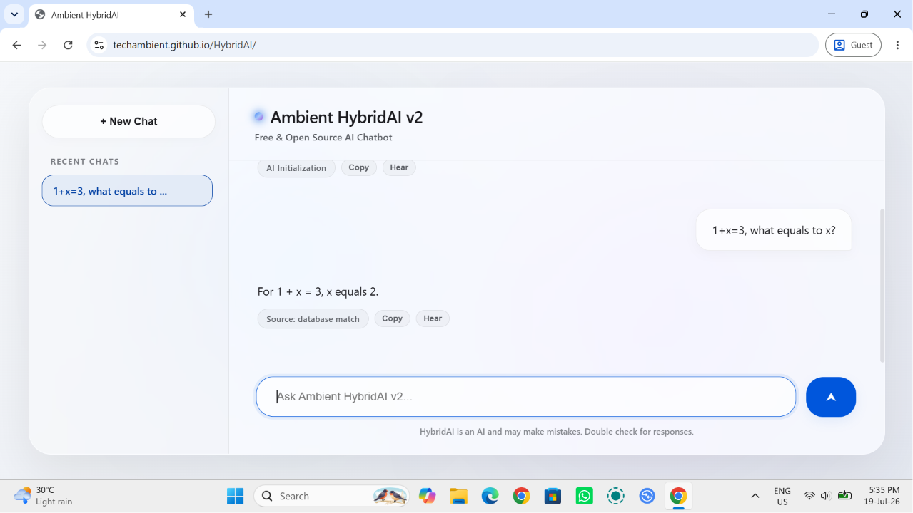
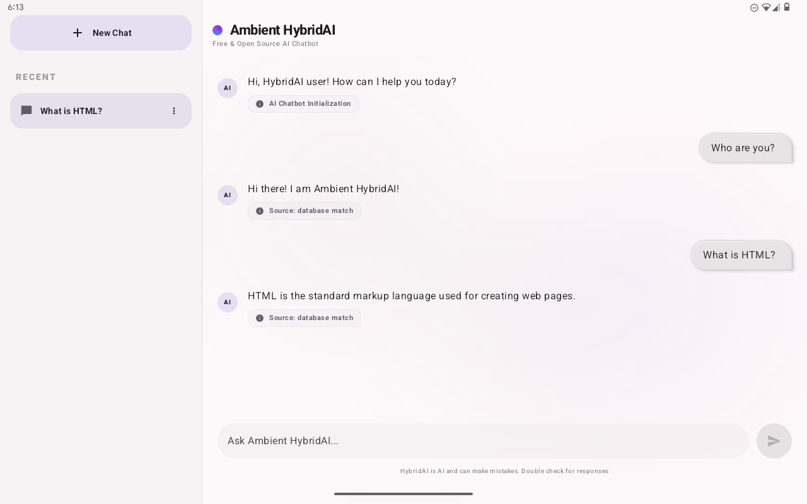
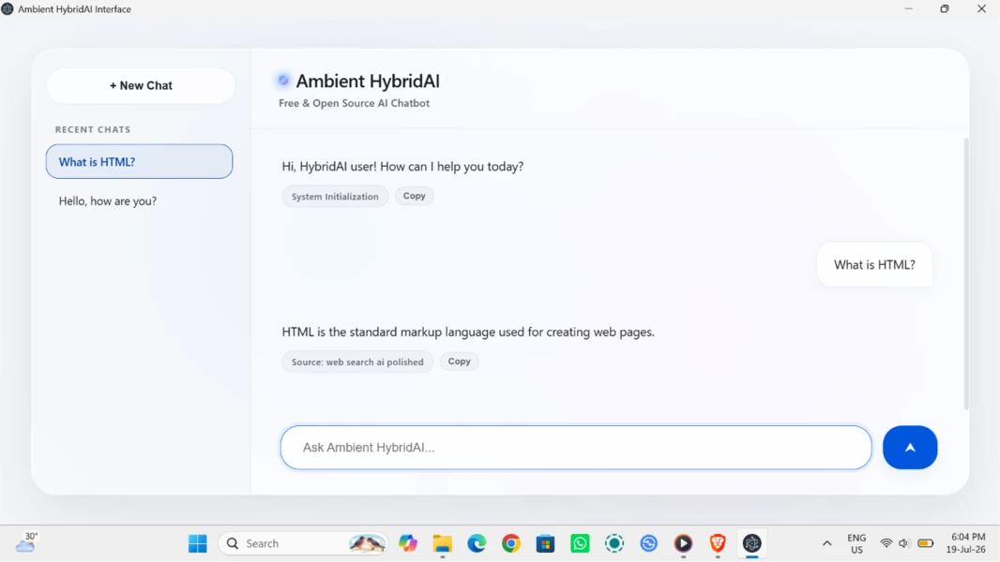

<div align="center">


# TalkVXR (formerly OpenHelper AI)

### Open source AI chatbot powered by TalkVXR v1 Flash

Modern, beautiful and free unlimited latest model usage AI assistant for Windows devices, Android phones, tablets and foldables.

[](LICENSE)
[]()
[]()

</div>

---

# 📖 About

TalkVXR is a modern open source AI chatbot designed for Android and Windows.

Powered by **TalkVXR v1 Flash**, it provides a fast, beautiful and intuitive AI experience through a clean Material 3 Expressive interface.

Whether you're asking questions, writing documents, generating ideas or solving problems, Ambient TalkVXR delivers an elegant AI experience designed specifically for Android and Windows. 

---

# ✨ Features

- 🤖 TalkVXR v1 Flash
- 💬 Modern AI Chatbot
- 🎨 Google Material 3 Expressive UI
- 📱 Optimised for phones
- 📟 Optimised for tablets & Windows
- 📖 Chat history
- 🌙 Dark Theme
- ☀️ Light Theme
- 🎨 Material You Dynamic Color
- ⚡ Fast and responsive
- 🚫 Zero Ads
- ❤️ Open Source

---

# 📸 Screenshots

<b>Web Version [For any device with web browser (eg. Chrome, Edge, Safari, etc.)]</b>

<p><p>

<b>Android Tab / Phone / Foldables Version [Android 10 & Up]</b>

<p><p>

<b>Windows Version [Windows 10 / 11 x64 / ARM64]</b>

<p><p>

---

# 📋 Requirements

- Android 10+ / Windows 10+
- ARM64 / x64 device
- Internet connection
- Minimum 4 GB RAM recommended

---

# 🔍 Reviews, Blogs & Discoveries
* Microsoft Bing: [https://www.bing.com/search?q=TalkVXR+AI](https://www.bing.com/search?q=TalkVXR+AI)
* Google AI Search: [https://www.google.com/search?q=TalkVXR+AI](https://www.google.com/search?q=TalkVXR+AI)
* DuckDuckGo: [https://duckduckgo.com/?ia=web&origin=funnel_home_website&t=h_&q=TalkVXR](https://duckduckgo.com/?ia=web&origin=funnel_home_website&t=h_&q=TalkVXR)
* Yahoo! Search: [https://search.yahoo.com/search?p=TalkVXR+AI](https://search.yahoo.com/search?p=TalkVXR+AI)
* Yandex: [https://yandex.com/search?text=TalkVXR+AI](https://yandex.com/search?text=TalkVXR+AI)
* Brave Search: [https://search.brave.com/search?q=TalkVXR+AI](https://search.brave.com/search?q=TalkVXR+AI)

---

# 🚀 Installation

Download the latest APK from the Releases page.

Or build from source:

```bash
git clone https://github.com/techambient/TalkVXR.git
```

Open the project using Android Studio / Electron (Windows version) and press **Run**.

---

# 🛠️ Built With

- Kotlin
- Jetpack Compose
- Material 3 Expressive
- AndroidX
- Kotlin Coroutines
- Markdown
- Gradle Kotlin DSL
- Electron (Windows version)
- HTML (Windows & Web version)

---

# 🧠 TalkVXR v1 Flash (Developed on October 10, 2026)

TalkVXR v1 Flash is the intelligence engine behind TalkVXR.

Features include:

- Natural language conversations
- Multi-turn context
- Intelligent responses
- Fast streaming responses
- Conversation memory
- Modern AI interaction

---

# 🎨 Design

TalkVXR follows Google's latest Material Design guidelines.

- Material 3 Expressive
- Material You
- Dynamic Color
- Edge-to-edge UI
- Adaptive layouts
- Responsive typography

---

# ❤️ Why TalkVXR?

Unlike many AI applications, TalkVXR focuses on:

- Clean UI
- Performance
- Open Source
- Modern Web, Android & Windows experience
- No unnecessary permissions
- Unlimited latest model usage

---

# 🤝 Contributing

Contributions are always welcome!

You can help by:

- Reporting bugs
- Suggesting features
- Improving documentation
- Submitting pull requests

---

# ⭐ Support

If you enjoy TalkVXR, please consider giving this repository a ⭐ to help keep it alive!! 

---

# 📄 License

Licensed under the MIT License.

See [LICENSE](LICENSE) for more information.

---

<div align="center">

Made with ❤️ by techambient (Ambient)

</div>
